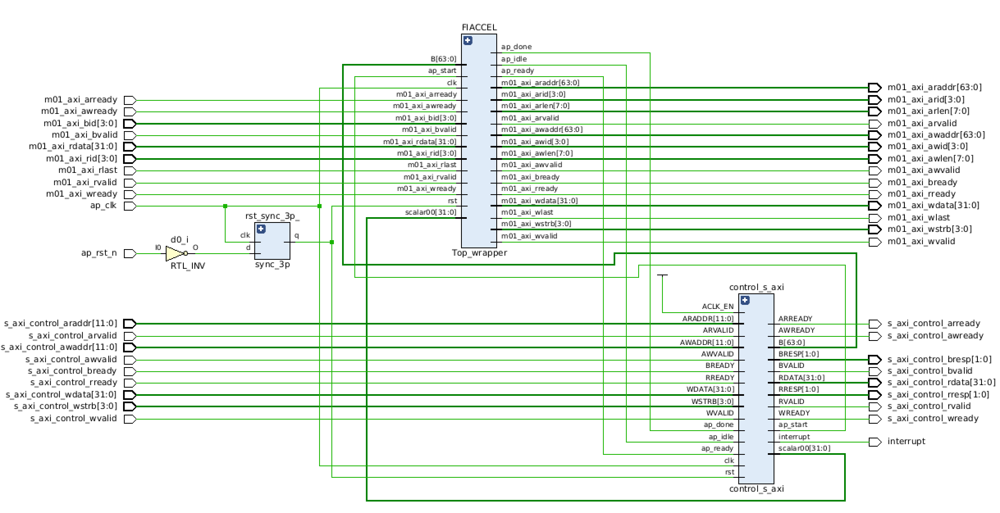
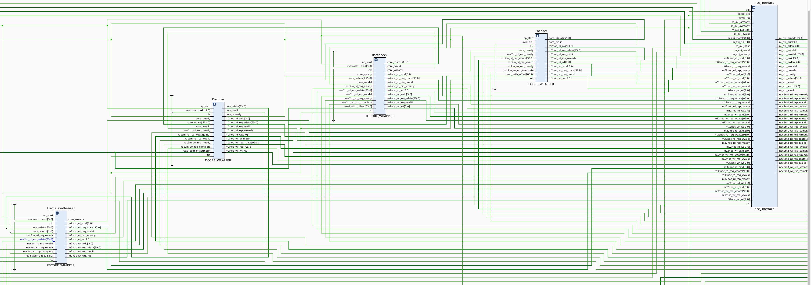
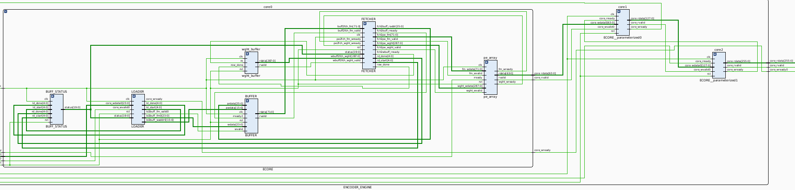
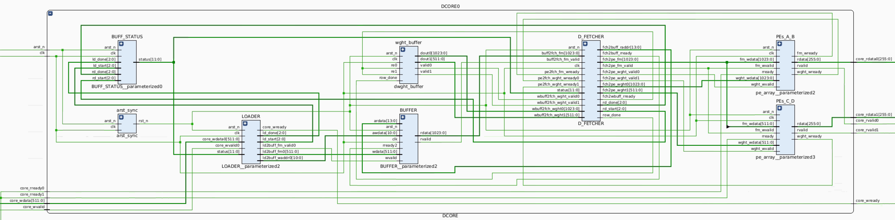
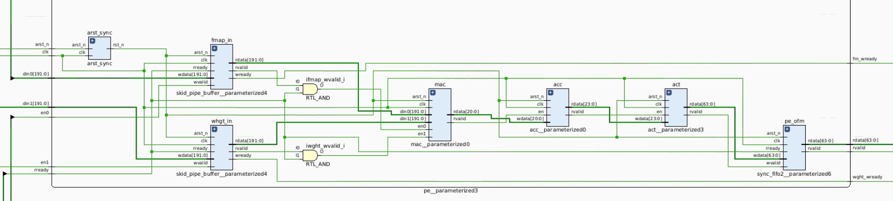
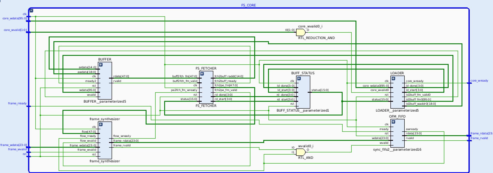
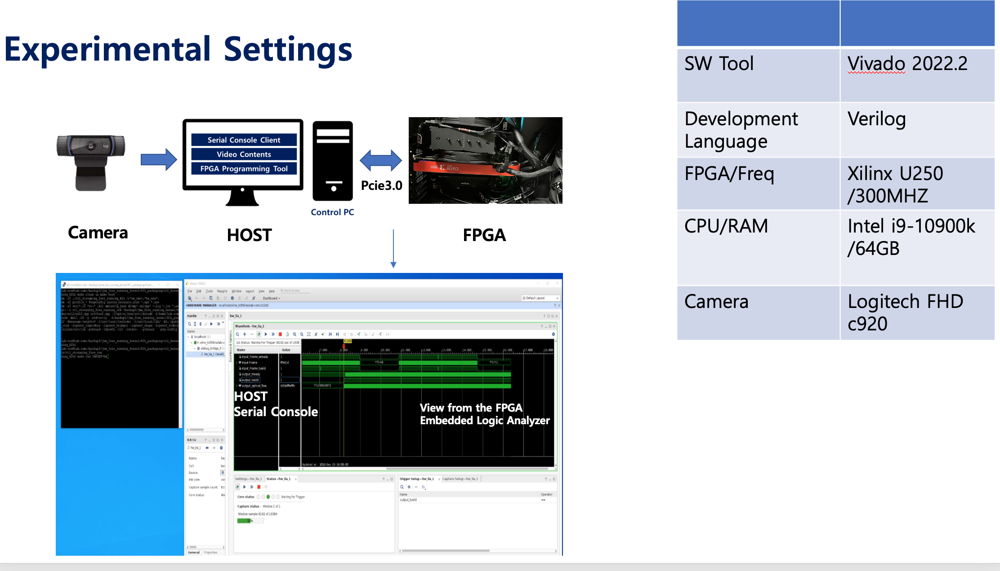

<div align="center">

# FIACCEL

**Memory Efficient Frame Interpolation Accelerator for Full-HD Video**

Min Wu Jeong, Chae Eun Rhee · Inha University

*IEEE Transactions on Circuits and Systems II: Express Briefs*, vol. 71, no. 4, pp. 2289–2293, 2024

[](https://doi.org/10.1109/TCSII.2023.3329966)
[](https://doi.org/10.1109/TCSII.2023.3329966)
[](https://pytorch.org/)
[](https://lightning.ai/)
[](https://hydra.cc/)
[](https://github.com/Xilinx/brevitas)
[](https://www.xilinx.com/products/boards-and-kits/alveo/u250.html)



</div>

---

## 📌 Overview

FIACCEL is a **memory-efficient, low-complexity accelerator for frame interpolation (FI)**.
Most FI methods target GPUs and have a high computational cost, so they are difficult to use in real-time on-device systems.
FIACCEL analyzes the most memory-inefficient part of the encoder–decoder structure and applies these schemes:

- **Feature map reuse**
- **Selective transfer to DRAM**
- **Row-wise layer fusion**
- **Kernel decomposition**
- **Parallelized horizontally dilated convolutions**

> 🎯 FIACCEL synthesizes **1920×1080** video from **90 fps to 180 fps in real time**, with an average PSNR of **31.98 dB** on Vimeo-90K.

A lightweight flow-estimation CNN predicts bidirectional optical flow and a blending mask from two input frames.
A frame synthesizer then warps both frames and blends them into the intermediate frame.
The full pipeline runs on a **Xilinx Alveo U250 at 300 MHz** and connects to the host over PCIe 3.0 with AXI interfaces.

This repository contains:

- 🧠 The PyTorch training code for the flow-estimation network, in **float** and **8-bit quantized (int)** versions.
- 🔧 The hardware block diagrams of the accelerator (TOP, Ecore, Dcore, PE, frame synthesizer).

## 🧠 Network

<table>
<tr><th>Stage</th><th>Layers</th><th>Channels</th></tr>
<tr><td>Encoder (shared, ×2 frames)</td><td>3 × Conv3×3, stride 2, ReLU</td><td>3 → 8 → 16 → 32</td></tr>
<tr><td>Bottleneck (ASPP)</td><td>4 × Conv3×3, dilation (1,1)…(1,4) + Conv1×1 shrink</td><td>64 → 64×4 → 64</td></tr>
<tr><td>Decoder</td><td>3 × ConvTranspose3×3, stride 2, ReLU</td><td>64 → 32 → 16 → 8</td></tr>
<tr><td>Head</td><td>Conv3×3 + Tanh</td><td>8 → 5 (flow<sub>0</sub>, flow<sub>1</sub>, mask)</td></tr>
</table>

The output frame is:

$$\hat{I}_t = M \odot \mathcal{W}(I_0, F_{t\to0}) + (1 - M) \odot \mathcal{W}(I_1, F_{t\to1})$$

The `int` version uses [Brevitas](https://github.com/Xilinx/brevitas) quantization-aware training (`QuantConv2d`, `QuantReLU`, 8-bit input) to match the fixed-point datapath on the FPGA.

## 📈 Results

<p align="center">
  
</p>

| Item | Value |
|:--|:--:|
| Resolution | 1920 × 1080 (Full-HD) |
| Frame rate | 90 fps → **180 fps** (real time) |
| PSNR on Vimeo-90K (paper) | **31.98 dB** |
| PSNR on Vimeo-90K val (training curve above) | 32.13 dB @ 154k steps |

## 🚀 Getting Started

### 1. Environment

Check that the PyTorch / CUDA version in `fiaccel.yaml` fits your machine. Then run:

```bash
conda env create -f fiaccel.yaml
conda activate fiaccel
```

### 2. Data

We train and validate on [Vimeo-90k](http://toflow.csail.mit.edu/) triplets ([Xue et al., 2019](https://arxiv.org/abs/1711.09078)).
Set `data_dir` in `config/datamodule/vimeo.yaml`.

### 3. Training

```bash
make train_float   # float model  (config/train_config_float.yaml)
make train_int     # 8-bit QAT model (config/train_config_int.yaml)
```

Hydra lets you override any value from the command line:

```bash
python model_train.py --config-name train_config_int ngpu=1 training_loop.train_batch_size=8
```

Logs go to [Weights & Biases](https://wandb.ai/). Set `checkpoint.callback.dirpath` and `hydra.run.dir` to your own paths before training.

## 🔧 Hardware Architecture

<details open>
<summary><b>TOP</b> — AXI master (data) + AXI-Lite slave (control)</summary>
<p align="center"></p>
</details>

<details>
<summary><b>TOP_SUB</b> — Top-level sub-module view</summary>
<p align="center"></p>
</details>

<details>
<summary><b>Ecore</b> — Encoder engine (loader, buffers, fetcher, PE array)</summary>
<p align="center"></p>
</details>

<details>
<summary><b>Dcore</b> — Decoder engine</summary>
<p align="center"></p>
</details>

<details>
<summary><b>PE</b> — Processing element</summary>
<p align="center"></p>
</details>

<details>
<summary><b>FS_CORE</b> — Frame synthesizer (warping + blending)</summary>
<p align="center"></p>
</details>

## 🧪 Experimental Settings

<p align="center"></p>

| Item | Setting |
|:--|:--|
| SW tool | Vivado 2022.2 |
| HDL | Verilog |
| FPGA / Freq | Xilinx Alveo U250 / 300 MHz |
| Host interface | PCIe 3.0 |
| CPU / RAM | Intel i9-10900K / 64 GB |
| Camera | Logitech FHD C920 |

## 📁 Repository Structure

```
FIACCEL/
├── config/               # Hydra configs (datamodule, model, optim, scheduler)
├── datamodules/          # Vimeo-90k triplet / septuplet loaders
├── neural/
│   └── flow_estimation.py  # float & Brevitas-quantized flow networks
├── utils/                # checkpoint loaders, schedulers, visualization
├── model_pipeline.py     # flow → warp → blend pipeline
├── model_lightning.py    # LightningModule
├── model_train.py        # training entry point
├── fig/                  # architecture & result figures
└── doc/                  # reference papers (SELF, elastic buffer, fused-layer CNN, AXI spec)
```

## 📝 Citation

If you find this work useful, please cite:

```bibtex
@article{jeong2024fiaccel,
  title   = {FIACCEL: Memory Efficient Frame Interpolation Accelerator for Full-HD Video},
  author  = {Jeong, Min Wu and Rhee, Chae Eun},
  journal = {IEEE Transactions on Circuits and Systems II: Express Briefs},
  volume  = {71},
  number  = {4},
  pages   = {2289--2293},
  year    = {2024},
  doi     = {10.1109/TCSII.2023.3329966}
}
```

## 🙏 Acknowledgements

- [Vimeo-90k](http://toflow.csail.mit.edu/) dataset
- [Brevitas](https://github.com/Xilinx/brevitas) for quantization-aware training
- [PyTorch Lightning](https://lightning.ai/) and [Hydra](https://hydra.cc/)
