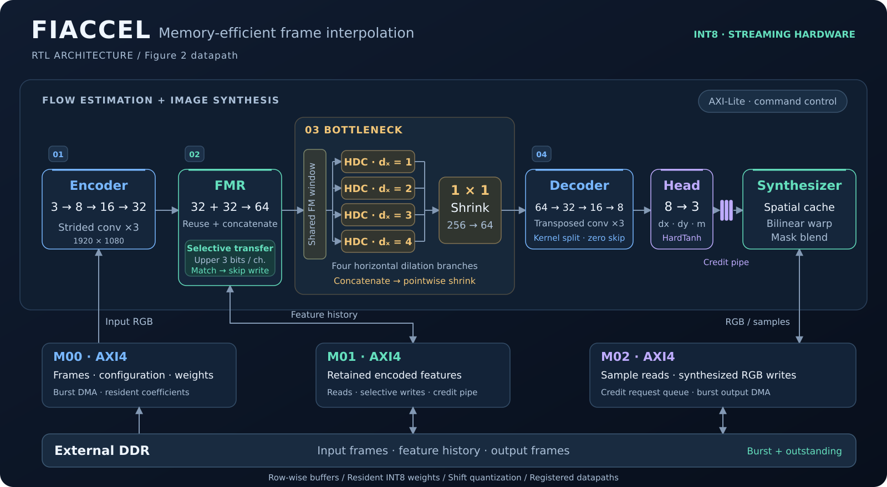
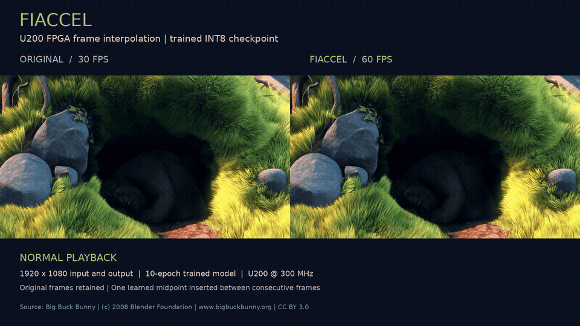
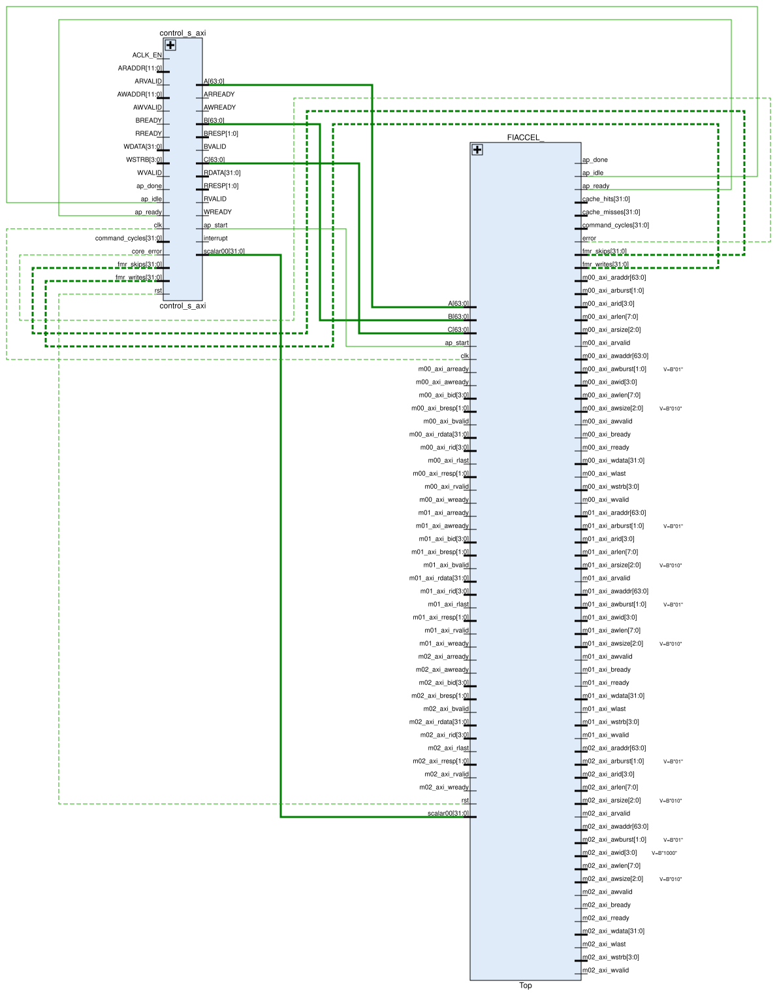

# FIACCEL

[](docs/architecture.md)

**Memory Efficient Frame Interpolation Accelerator for Full-HD Video**<br>
Min Wu Jeong · Chae Eun Rhee | Inha University | IEEE TCAS-II, 2024

[Paper](https://doi.org/10.1109/TCSII.2023.3329966) · [Architecture](docs/architecture.md) · [Training](docs/training.md) · [RTL guide](hardware/README.md) · [U200 host](hardware/u200/README.md)

INT8 frame interpolation with feature reuse, selective DRAM transfer,
row-wise fusion and kernel decomposition. RTL is provided as **30 encrypted
modules** in [`rtl_vp/`](rtl_vp/), with XSim simulation-only access.

## U200 demo

[](media/fiaccel_u200_demo.mp4)

[Watch / download MP4](media/fiaccel_u200_demo.mp4) · [U200 build image](https://github.com/Miinuuu/FIACCEL/raw/refs/heads/main/hardware/u200/prebuilt/FIACCEL.xclbin) · [Board guide](hardware/u200/README.md) · [INT8 weights](weights/u200_int8/README.md)

Full-HD **30 fps input → 60 fps output video**, using a trained INT8 model on
Alveo U200 at **300 MHz**. Six reference frames matched byte for byte;
the video run produced **120 output frames from 60 input frames**.

<details>
<summary>Vivado top schematic</summary>

<a href="docs/assets/fiaccel_vivado_top.svg"></a>

[Core integration schematic](docs/assets/fiaccel_vivado_core.svg) · [View details](docs/architecture.md#vivado-rtl-schematics)

</details>

## Run on U200

Requires Linux, an idle **Alveo U200**, XRT headers/libraries, a C++17 compiler,
Python 3 and FFmpeg/FFprobe. Use the [compatible platform](hardware/u200/README.md#validated-on-hardware)
and run from the repository root:

```bash
source /opt/xilinx/xrt/setup.sh
unset XCL_EMULATION_MODE FIACCEL_CONFIG_SMOKE
make -C sw host
make check-public
python3 sw/video/interpolate_video.py input_1080p.mp4 output_1080p60.mp4 \
  --xclbin hardware/u200/prebuilt/FIACCEL.xclbin \
  --host build/u200/host --weights weights/u200_int8/config.hex
```

Input must be **1920×1080**. A 30 fps source produces a 60 fps output file,
with original frames and learned midpoints. Logs and frame counts are saved in
`output_1080p60.mp4.fiaccel/`. See the [board guide](hardware/u200/README.md) for details.

## Hardware emulation (hw_emu)

Requires **Vitis/Vivado 2024.2** and XRT. The [hw_emu image and settings](hardware/u200/hw_emu/)
are included; the separate U200 board image is for physical hardware.
After sourcing the Vitis and XRT environment scripts, run:

```bash
make -C sw host
mkdir -p build/hw_emu
cp hardware/u200/hw_emu/{FIACCEL.xclbin,emconfig.json,xrt.ini} build/hw_emu/
make check-public
export XCL_EMULATION_MODE=hw_emu EMCONFIG_PATH="$PWD/build/hw_emu"
export XRT_INI_PATH="$EMCONFIG_PATH/xrt.ini"
FIACCEL_CONFIG_SMOKE=1 FIACCEL_TIMEOUT_SECONDS=120 \
  build/u200/host build/hw_emu/FIACCEL.xclbin
unset XCL_EMULATION_MODE EMCONFIG_PATH XRT_INI_PATH
```

This checks configuration/control AXI. See the [hw_emu guide](hardware/u200/README.md#hardware-emulation-hw_emu)
for a two-frame video run. Full-HD RTL emulation can take hours; the small
XSim fixture below is the quick functional check.

## RTL simulation

Requires **Vivado 2024.2 (Linux)** on `PATH` and **Python 3**.

```bash
make sim        # 32-bit AXI
make sim-wide   # 256-bit AXI
make sim-waves  # selected internal signals / WDB
```

Both check 256 RGB pixels using a synthetic 16×8, three-frame fixture.
Results: `build/public_xsim/validation.json` and `build/public_xsim_256/validation.json`.
This demo checks functionality; see the [RTL guide](hardware/README.md) for scope.

## Contents

| Path | Contents |
|---|---|
| `rtl_vp/` | Encrypted RTL grouped by core, AXI, network, memory, PE, FIFO and synthesis |
| `hardware/sim/`, `hardware/u200/` | AXI simulation and U200 board/emulation images |
| `sw/` | U200 XRT host and video I/O |
| `weights/u200_int8/`, `media/` | Trained integer model and board demo |
| `model/` | Network, selective transfer, synthesis and hardware QAT |
| `training/` | Trainer, datasets, configuration and launch scripts |
| `docs/` | Architecture, guides, figures and reference papers |
| `tests/` | Model and training regression tests |

<details>
<summary>Citation</summary>

```bibtex
@article{jeong2024fiaccel,
  title   = {FIACCEL: Memory Efficient Frame Interpolation Accelerator for Full-HD Video},
  author  = {Jeong, Min Wu and Rhee, Chae Eun},
  journal = {IEEE Transactions on Circuits and Systems II: Express Briefs},
  volume  = {71},
  number  = {4},
  pages   = {2289--2293},
  year    = {2024},
  doi     = {10.1109/TCSII.2023.3329966}
}
```

</details>
