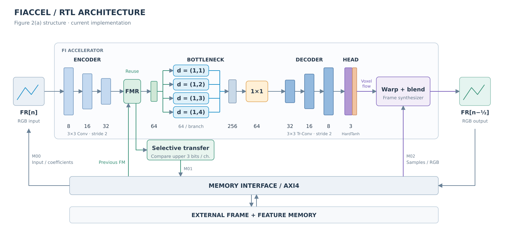
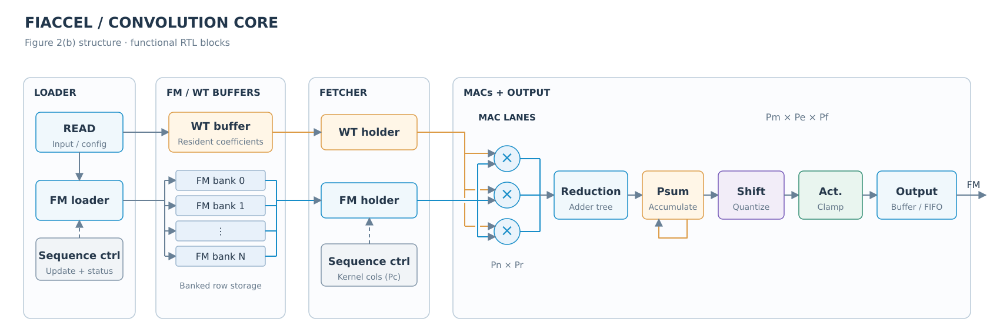

# RTL architecture

[← Project overview](../README.md) · [RTL simulation](../hardware/README.md)

## Accelerator

The layout follows Figure 2(a) of the [FIACCEL paper](https://doi.org/10.1109/TCSII.2023.3329966),
redrawn against the current RTL and Python model. The three encoder stages feed
FMR; the previous encoded feature and the current feature are concatenated and
broadcast to four horizontal dilation branches. A 1×1 shrink layer feeds three
decoder stages. The three-channel HardTanh head produces horizontal motion,
vertical motion and a mask for the frame synthesizer.

Selective transfer compares the upper three bits per encoded channel. Matching
signatures skip the write and retain the prior memory representative. The first
frame initializes history; subsequent frames produce midpoint outputs.

| Interface | Current RTL role |
|---|---|
| M00 | Input frames, descriptors and coefficient configuration |
| M01 | Encoded-feature reads and selective writes |
| M02 | Frame-sample reads and interpolated RGB writes |

## Convolution core

The layout follows Figure 2(b): Loader → banked FM/WT buffers → Fetcher/holders
→ MACs → reduction → partial sums → scaling and activation → output buffer.
The current implementation reuses resident weights, sequences kernel columns,
uses decomposed transpose-convolution kernels to skip inserted zeros, and
implements quantization scales as shifts.

`Pn` and `Pr` describe input-channel and kernel-row axes; the kernel-column loop
corresponds to `Pc`. `Pm`, `Pe` and `Pf` describe output-channel and spatial axes.
The MAC glyphs and FM bank rows are schematic, with physical replication and
buffer capacities omitted.

## Vivado RTL schematics

Static SVG exports from the current development RTL, generated by Vivado 2024.2
RTL elaboration with 1920×1080 dimensions and 32-bit AXI masters.
The views show hierarchical module instances and their connections, with leaf
logic collapsed. Open an SVG to zoom into signal names.

| View | Module connections |
|---|---|
| [FIACCEL top](../fig/fiaccel_vivado_top.svg) | AXI-Lite control and the `Top` core wrapper |
| [Core integration](../fig/fiaccel_vivado_core.svg) | Input/output DMA, `fi_engine`, and the three `fi_axi` masters |

## Code correspondence

| Figure block | Protected RTL | Public model |
|---|---|---|
| Encoder, HDC branches, shrink, decoder, head | `fi_network.vp`, `fi_conv.vp` | `model/flow_estimation.py` |
| FMR / selective transfer | `fi_fmr.vp` | `model/selective_transfer.py` |
| Frame synthesizer | `fi_synth.vp`, `fi_blend_pipe.vp` | `model_pipeline.py` |
| FM/WT storage and loading | `fi_fm_*.vp`, `fi_wt_*.vp`, `fi_weights.vp` | — |
| MAC and reduction | `fi_dsp_mac4.vp`, `fi_reduce_tree.vp` | — |
| Output queue / elastic and credit transport | `fi_vector_fifo.vp`, `fi_skid_buffer.vp`, `fi_slr_credit.vp` | — |

These diagrams describe the current implementation using the paper's layout.
They do not assert that the U200-derived evaluation reproduces the published
U250 timing, resource usage or image quality.
