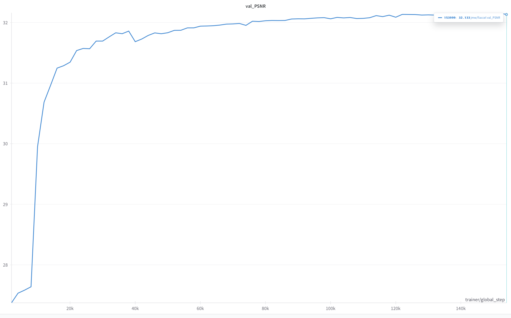

# Training and streaming inference

[← Project overview](../README.md) · [RTL evaluation](../hardware/README.md)

## Environment

The Python model and the protected RTL demo have separate dependencies.
For training, review the PyTorch/CUDA versions in `fiaccel.yaml` for your machine:

```bash
conda env create -f fiaccel.yaml
conda activate fiaccel
```

Run commands from the repository root. Training uses PyTorch, Lightning,
Hydra and Brevitas. The environment is based on the research training setup;
it is not required for the XSim demo.

## Dataset

Use Vimeo-90K triplets and set `data_dir` in
[`config/datamodule/vimeo.yaml`](../config/datamodule/vimeo.yaml).
Update checkpoint directories, Hydra output directories and logging settings
for your environment before starting a run.

```bash
make train_float
make train_int
```

Hydra overrides can be supplied directly:

```bash
python model_train.py --config-name train_config_int ngpu=1 training_loop.train_batch_size=8
```

### H200 INT8 QAT

The H200 profile uses two GPUs with a batch of 16 each (32 total), 256×256
crops and AdamW at 2e-4, and stops after 10 epochs (about 16,040 training steps
for 51,313 triplets). It trains the
Brevitas INT8 model from scratch with FP32 arithmetic for fake quantization.
Vimeo triplets are read from `/data/jmw/vimeo_triplet`. Full validation runs
at the end of the epoch; the best two checkpoints and `last.ckpt` are saved after
validation. Training diagnostics are computed without gradients every 100
steps. Validation uses batches of 32 images per GPU and retains the mean per-image PSNR
over the full validation set. Persistent data workers and cuDNN algorithm
selection reduce loading and convolution overhead. Metrics are saved as CSV
and W&B offline files.

On H200, with sources at `/data/jmw/fiaccel/src` and the training environment
at `/data/jmw/fiaccel/.venv`:

```bash
tmux new-session -d -s fiaccel_qat \
  'bash /data/jmw/fiaccel/src/scripts/train_h200_qat.sh'
tmux attach -t fiaccel_qat
```

Each run under `/data/jmw/fiaccel/runs/qat_*` contains a source snapshot,
resolved Hydra settings, package versions, `train.log`, `csv_logs/`, and
`checkpoints_int/`. `exit_code` appears when the launcher exits.
Set `FIACCEL_RUN_DIR` to choose a new run directory.
To resume an existing run with updated sources and the same optimizer and
scheduler states:

```bash
FIACCEL_RUN_DIR=/data/jmw/fiaccel/runs/qat_RUN FIACCEL_RESUME=1 \
  bash /data/jmw/fiaccel/src/scripts/train_h200_qat.sh
```

Resuming creates a separate `source_resume_*` snapshot and retains the
previous Hydra settings with that snapshot. A missing checkpoint is an error.

## Current model interface

The head produces `[flow_x, flow_y, mask]` with a HardTanh activation.
The synthesis pipeline in `model_pipeline.py` converts those channels to an
intermediate image at `t=0.5`. A five-channel checkpoint must be converted or
retrained for this model interface; silently truncating the head is unsupported.

Streaming inference uses `model.eval()`, `reset_stream()` and `forward_frame()`.
The first frame initializes encoder history and returns no interpolated image.
Each following frame is paired with the retained previous frame.
Selective transfer compares encoded feature representatives and retains the
previous representative when the transfer rule permits reuse.

Float inference requires a calibrated feature scale. Quantized inference uses
the encoder's fixed evaluation scale. These model paths do not establish
bit-exact RTL arithmetic or the published PSNR without matching trained weights
and quantization settings.

## Results and figures



The curve is a research training artifact. The public RTL demo uses synthetic
weights and verifies arithmetic/transport against a supplied small fixture;
it does not measure learned interpolation quality.
