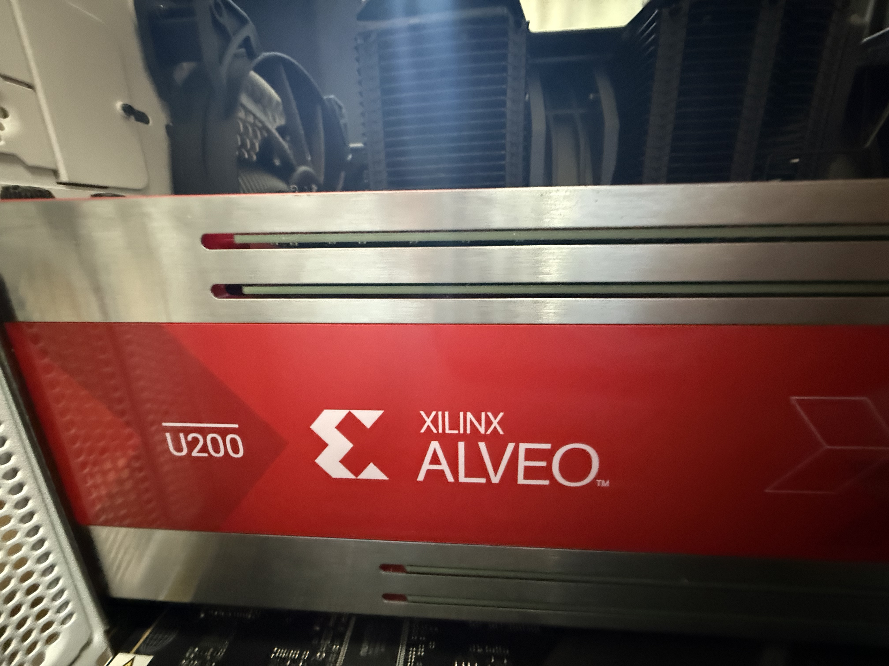

# U200 board demo

[Project overview](../../README.md) · [Demo MP4](../../media/fiaccel_u200_demo.mp4) · [XSim evaluation](../README.md)

**Board build image:** [Download FIACCEL.xclbin](https://github.com/Miinuuu/FIACCEL/raw/refs/heads/main/hardware/u200/prebuilt/FIACCEL.xclbin)
— 60.3 MB, U200 / 300 MHz. [Image manifest and SHA-256](prebuilt/manifest.json).



Alveo U200 installed in the server.

## Validated on hardware

| Item | Result |
|---|---|
| Tools / platform | Vivado and Vitis 2024.2 / `xilinx_u200_gen3x16_xdma_2_202110_1` |
| Hardware build | Completed; 300 MHz kernel clock |
| Model | 10-epoch trained INT8 weights; 12 shift scales |
| Exact reference check | 3 input frames → 6 output frames; all 37,324,800 RGB bytes match |
| MP4 pipeline | 1920×1080, 30 fps / 60 frames → 60 fps / 120 frames |

The reference check models selective transfer with persistent feature
representatives. The video pipeline runs FFmpeg decode → XRT host → U200
→ FFmpeg encode. Output order is original A → midpoint A/B → original B;
the final original is repeated once to preserve duration.
FPS above describes the encoded video. [Validation summary](validation.json).

## Build the host and run a video

Requires Linux, a C++17 compiler, XRT development headers/libraries,
FFmpeg/FFprobe and the U200 platform listed above.
Use an idle U200 and run from the repository root:

```bash
make -C sw host
python3 hardware/scripts/check_public.py
python3 sw/video/interpolate_video.py input_1080p.mp4 output_1080p60.mp4 \
  --xclbin hardware/u200/prebuilt/FIACCEL.xclbin \
  --host build/u200/host --weights weights/u200_int8/config.hex
```

Frames pass through bounded pipes. Three input BOs and two output BOs are
allocated once and reused: the next input upload and previous output readback
overlap the current FPGA command. Kernel commands remain ordered to preserve
selective-transfer history. Host frame storage is also reused; memory use is
independent of video length. The command
writes frame counts and execution metadata beside the output video.
The default fixed-pattern host self-test loads synthetic coefficients;
the video command above loads the published trained weights.

`HOST_PROFILE` reports measured stream time, while `VIDEO_SUMMARY` reports
frame counts. Add `--serial` to the host's `--video-stream` command to compare
with serial scheduling. CPU checks require no board: `make -C sw test`.

## Hardware emulation (hw_emu)

Hardware emulation runs the RTL and modeled memories on the CPU; no U200 is
required. Install Vitis/Vivado 2024.2 and XRT. The compiled
[hw_emu image](hw_emu/FIACCEL.xclbin), `emconfig.json` and `xrt.ini` are included
in [`hw_emu/`](hw_emu/). The image uses the current 30-module RTL and 300 MHz
modeled clocks; its relocated configuration/control/M00 AXI smoke test passed.
[Manifest and checksums](hw_emu/manifest.json). The separate
`prebuilt/FIACCEL.xclbin` is for physical hardware.

From the repository root, prepare the environment and run the configuration smoke:

```bash
source /path/to/Vitis/2024.2/settings64.sh
source /opt/xilinx/xrt/setup.sh
make -C sw host
mkdir -p build/hw_emu
cp hardware/u200/hw_emu/{FIACCEL.xclbin,emconfig.json,xrt.ini} build/hw_emu/
make check-public
export XCL_EMULATION_MODE=hw_emu
export EMCONFIG_PATH="$PWD/build/hw_emu"
export XRT_INI_PATH="$PWD/build/hw_emu/xrt.ini"
FIACCEL_CONFIG_SMOKE=1 FIACCEL_TIMEOUT_SECONDS=120 \
  build/u200/host build/hw_emu/FIACCEL.xclbin
```

The smoke command prints `PASS configuration/control/m00 AXI smoke only`.
To exercise coefficient loading, warm-up, interpolation and video output,
start with two Full-HD source frames:

```bash
unset FIACCEL_CONFIG_SMOKE
ffmpeg -nostdin -i input_1080p.mp4 -frames:v 2 -an \
  -c:v libx264 -crf 0 -threads 2 build/hw_emu/input_2frames.mp4
FIACCEL_TIMEOUT_SECONDS=43200 python3 sw/video/interpolate_video.py \
  build/hw_emu/input_2frames.mp4 build/hw_emu/output.mp4 \
  --xclbin build/hw_emu/FIACCEL.xclbin \
  --host build/u200/host --weights weights/u200_int8/config.hex
unset XCL_EMULATION_MODE EMCONFIG_PATH XRT_INI_PATH
```

Two input frames produce four output frames, including one midpoint and the
final held original. Logs and frame counts are in
`build/hw_emu/output.mp4.fiaccel/`. Full-HD emulation can take hours; its
runtime and modeled-memory cycle counts do not establish board throughput.
Clear the emulation environment before returning to physical-board execution.

## Hardware build configuration

The completed development build used three 32-bit AXI masters, bursts up to
256 beats and up to eight outstanding requests. [`link.cfg`](link.cfg) maps
M00/M02 to DDR0 and M01 to DDR1, requests 300 MHz, and selects SLR balancing,
congestion-aware placement and physical optimization. Vitis frequency scaling
was enabled; the completed design retained 300 MHz.

For a development environment with an independently supplied FIACCEL kernel XO:

```bash
mkdir -p build/u200
v++ -t hw \
  --platform xilinx_u200_gen3x16_xdma_2_202110_1 \
  --config hardware/u200/link.cfg \
  -l /path/to/FIACCEL.xo -o build/u200/FIACCEL.xclbin
```

The encrypted RTL in this repository permits XSim evaluation and signal
inspection. It does not permit synthesis or bitstream generation. The command
above requires a separately authorized kernel XO. The prebuilt xclbin is
provided for board execution; it does not change the protected RTL permissions.
